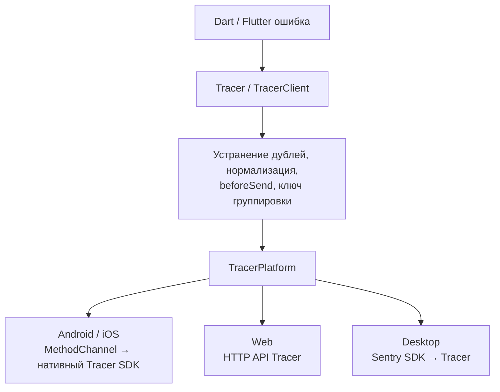

# Архитектура проекта

Проект устроен как федеративный Flutter-плагин: приложение работает через
единый API `Tracer`, а конкретная платформа отвечает за доставку событий и
управление своим SDK.

## Разделение пакетов

| Пакет | Ответственность |
|---|---|
| `apptracer_flutter` | Публичный API, перехват Dart/Flutter-ошибок, фильтрация, устранение дублей, breadcrumbs |
| `apptracer_flutter_platform_interface` | Контракт `TracerPlatform`, модели событий и настроек, парсер стеков, общий `MethodChannelTracer` |
| `apptracer_flutter_android` | Мост на Kotlin к нативному Tracer SDK |
| `apptracer_flutter_ios` | Мост на Swift к OKTracer |
| `apptracer_flutter_web` | Браузерная реализация, использующая HTTP-транспорт |
| `apptracer_flutter_http` | Отправка в собственный HTTP API Tracer на Dart |
| `apptracer_flutter_desktop` | Опциональная реализация для macOS, Windows и Linux через официальный Sentry SDK |
| `apptracer_flutter_sentry` | Старый ручной HTTP-транспорт по протоколу Sentry; не является текущим desktop-адаптером |

Платформенные реализации наследуют `TracerPlatform` и регистрируются через
`TracerPlatform.instance`. Пока реализация не зарегистрирована, используется
неактивный `UnsupportedTracerPlatform`.

Основной пакет объявляет Android, iOS и Web реализациями по умолчанию.
Desktop подключается отдельной зависимостью и после её добавления
регистрируется автоматически на поддерживаемых desktop-платформах.

## Путь ошибки



Общая обработка находится в
[`TracerClient`](../packages/apptracer_flutter/lib/src/tracer_client.dart).
Он устраняет повторные сообщения об одной ошибке, нормализует исключение и
стек, добавляет пользовательские ключи и breadcrumbs, применяет `beforeSend`.
Если платформе нужен синтетический ключ группировки, он вычисляется после
фильтрации, когда вызывающая сторона не задала свой `issueKey`.
Затем событие передаётся платформенной реализации.

Запуск приложения через `appRunner` и охраняемая Dart-зона принадлежат
[`Tracer`](../packages/apptracer_flutter/lib/apptracer_flutter.dart).
Платформенные реализации запускают транспорт, но не приложение. Это позволяет
централизованно гарантировать вызов `appRunner` ровно один раз даже при отказе
интеграции и не дублировать обработчики ошибок на каждой платформе.

Нативный крэш идёт другим путём: его ловит сам нативный SDK, без прохождения
через Dart-обработчик и Dart-фильтр `beforeSend`. Поэтому для нативных отчётов
важны собственные настройки SDK и управление сбором данных. Подробнее — в
[документации о приватности](privacy.md).

## Связь Dart с нативным кодом

Android и iOS используют общий
[`MethodChannelTracer`](../packages/apptracer_flutter_platform_interface/lib/src/method_channel_tracer.dart)
с каналом `ru.apptracer.flutter/tracer`. Например, отправка ошибки проходит
через вызов:

```dart
await _channel.invokeMethod<void>('recordError', event.toMap());
```

1. Dart сериализует `TracerEvent` в карту.
2. Kotlin выбирает обработчик через `when (call.method)`, Swift — через
   `switch call.method`.
3. Нативная сторона читает поля и вызывает SDK.

На Android создаётся `DartError`, его стек заменяется кадрами из Dart, затем
вызывается `TracerCrashReport.report(...)`. В отчёт попадает исходная
Dart-ошибка, а не стек самого плагина.

Контракт между языками поддерживается вручную: имена методов, ключи карт,
типы полей и обработчики должны совпадать. При добавлении поля или метода
нужно согласованно менять Dart-модель и канал, Kotlin, Swift и соответствующие
тесты. Тесты канала проверяют сериализацию и поведение при ошибках.

Сбой интеграции не должен ломать приложение. Мост обрабатывает отсутствие
плагина и ошибки платформенных вызовов, а операции управления сбором
возвращают `TracerCollectionResult` с состоянием и причиной отказа.

## Почему desktop — отдельный пакет

Главная причина — сделать Sentry необязательной зависимостью. Для Android и
iOS используются SDK Tracer, поэтому основной `apptracer_flutter` не должен
подключать Sentry всем приложениям ради desktop. Это решение зафиксировано в
[README desktop-пакета](../packages/apptracer_flutter_desktop/README.md#зависимости-и-переход).

Разделение также отражает отличия реализации:

- **Другой механизм доставки.** Desktop использует `sentry_flutter` и DSN
  проекта Tracer. Данные отправляются в Tracer; Sentry предоставляет SDK и
  протокол.
- **Собственный нативный жизненный цикл.** Адаптер управляет очередями отчётов,
  отправкой, остановкой и очисткой сбора, необходимостью перезапуска. На macOS
  есть отдельный `MethodChannel` для lifecycle, на Windows и Linux используется
  FFI. Здесь же находятся работа с символами и упаковка нативных библиотек.
- **Отдельная совместимость зависимостей.** В текущей реализации
  `sentry_flutter` закреплён на версии `9.30.1`. Обновление требует проверки
  интеграций и нативного поведения; оно не должно навязывать эту зависимость
  пользователям мобильного и web-пакетов.

При этом desktop реализует тот же `TracerPlatform`. Приложение продолжает
использовать `Tracer.initialize`, `Tracer.recordError` и остальные общие методы.
Дополнительно вызывать `SentryFlutter.init` не нужно: SDK принадлежит адаптеру.
Обработчики Dart-ошибок остаются под управлением `Tracer`; desktop-конфигурация
отключает соответствующие автоматические интеграции Sentry, чтобы не
отправлять одну ошибку дважды.

У разделения есть граница: если добавить desktop-пакет в единое приложение
для мобильных и desktop-платформ, `sentry_flutter` принесёт свои транзитивные
нативные зависимости для Android и iOS. Условный Dart-import их не исключает.
Отдельный пакет позволяет отказаться от этой зависимости; полностью отделить
её от мобильных сборок позволяет отдельное desktop-приложение.

Установка, требования к сборке и переход со старого ручного транспорта
описаны в [desktop-migration.md](desktop-migration.md). Другие обоснования
архитектурных решений собраны в [design-decisions.md](design-decisions.md).
